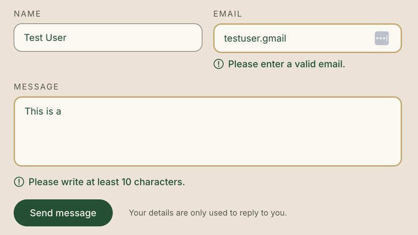
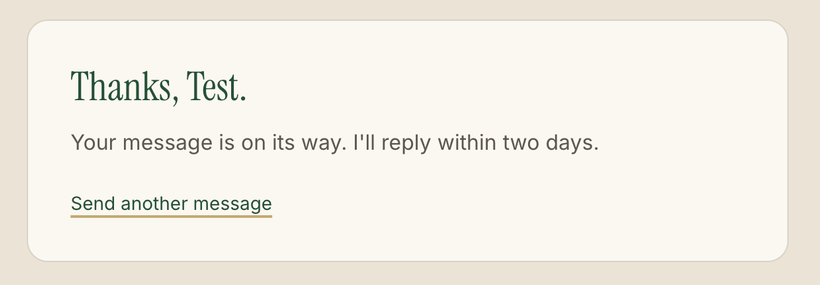
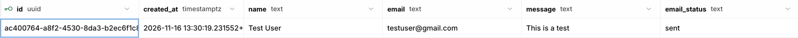
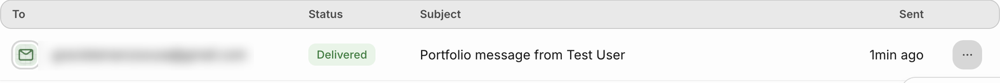
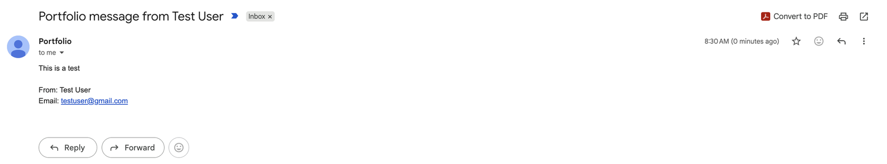

# Walkthrough

My submission for the Porter & Co take-home, Option 1: a personal portfolio.

- **Live site:** https://gracielamsousa.vercel.app
- **Deeper reference:** [DECISIONS.md](DECISIONS.md) logs every decision with the alternatives considered.

## Priorities

1. **Let the work speak:** three case studies that show how I think, from the problem to the results.
2. **Show reasoning, not just features:** every case study explains its key decisions and what I'd improve, and two let you try a decision in an interactive demo.
3. **Polish what matters:** a calm, focused site that works on any screen and for any visitor.

## How the brief is met

| Requirement | Where |
| --- | --- |
| Introduction | The hero and the experience timeline |
| 2–3 projects with role, decisions, and results | Three case studies |
| Working contact form | Saved to Supabase, then emailed through Resend |
| Deployed | Vercel, with a preview for every pull request |
| Mobile and desktop | Mobile-first layouts, tested at phone, tablet, and desktop widths |
| Accessibility | Semantic structure, keyboard support, labeled forms, contrast, reduced motion |
| Loading, success, and error states | The contact form, case studies, video player, and demos |
| Mock data | Both demos are labeled and run only in the browser |

## Design decisions

**The projects.** The featured case study is an attribution product I built that traces each sale back to the content that drove it, a question Porter raised. The other two show AI agent design, with a hard rule enforced in code rather than in a prompt, and an internal admin platform built for safety with production data.

**A calm, editorial look.** Warm cream, forest green, and a serif display face, with gold reserved for highlights, so the content leads.

**Case studies built for skimming.** Each opens with a diagram beside a facts panel (role, dates, outcome, stack), then problem, role, key decisions, results, and what I'd improve.

**Diagrams instead of screenshots.** Most of this work is proprietary, so each project gets an SVG diagram in the site's palette that explains the system without showing private data.

**Interactive demos.** One tests the outbound email allowlist, including a look-alike domain. The other recreates a supplier merge with its guardrails and ends with a report of exactly what moved.

**Clear links.** ▶ plays a video in an on-page player, → opens a case study, and the GitHub logo opens code in a new tab.

## Technical choices

**Next.js with static pages.** Pages are generated at build time, so they load fast. Case-study links prefetch the full page, and server-only code keeps secrets out of the browser.

**Content as typed data.** Projects and the timeline live in typed TypeScript files, so a missing field fails the build instead of breaking a page.

**The contact form.** It validates as you type with the same function the server uses. The API rejects oversized requests, discards bot submissions with a honeypot, and validates again. Messages are **saved before they are emailed**, so none are lost if email delivery fails. Logs contain IDs only, and the database is closed to public access.

<strong>The form working end to end</strong> (screenshots from the live site)

1. Invalid input is explained inline, next to each field:

   

2. A valid message shows a confirmation:

   

3. The message is saved in Supabase first, then marked `sent` once the email goes out:

   

4. Resend reports it delivered:

   

5. And it arrives in my inbox:

   

**Diagrams and demos as tested code.** Diagrams are React components built from shared parts, with full text descriptions for screen readers. The demo rules are small pure functions with unit tests, so each demo shows what the real system does.

**Accessibility.** Landmarks and heading order, a skip link, visible focus, full keyboard support, announced form errors, text alternatives for every diagram and image, AA contrast, and reduced-motion support. The video player uses the native `<dialog>` element, so focus and Esc work as expected.

**Quality.** 25 unit tests, plus lint and type checks with no warnings.

## What I would build next

- A skill filter and a natural-language project search: a visitor describes what they're looking for and an LLM matches it to the relevant case studies, explaining the match, with keyword search as a fallback
- Rate limiting on the contact form with a shared store such as Redis, and Cloudflare Turnstile if spam appears
- A custom sending domain for the contact emails, and an optional confirmation email with abuse protection
- End-to-end tests (Playwright) and automated accessibility checks in CI for the form, the video player, and every page
- Mobile-specific diagram layouts that stack vertically
- Case studies in MDX as the writing grows
- A retry job for submissions whose email failed
- A small authenticated admin page for submissions
- Zod and React Hook Form if the form grows
- A dark theme
- Analytics

The template, libraries, and AI tools I used are listed in the [README](../README.md#templates-libraries-and-ai-tools).
